# KickIQ ⚽
### Football Performance Analytics and Decision Support System

KickIQ is a web-based football analytics platform that helps users explore player performance, evaluate recent form, compare players, and view machine-learning-based next-match rating estimates with explainable AI insights.

The project is built with Django and MySQL. It combines match-by-match player statistics, the custom Football Form Index (FFI), a Random Forest regression pipeline, SHAP explanations, interactive visualisations, and downloadable PDF reports.

> **Project status:** Academic/MCA mini-project. Model estimates are experimental decision-support outputs, not guaranteed match ratings or scouting decisions.

---

## Contents
- [Features](#features)
- [Application Screenshots](#application-screenshots)
- [Technology Stack](#technology-stack)
- [How KickIQ Works](#how-kickiq-works)
- [Football Form Index (FFI)](#football-form-index-ffi)
- [Rating Prediction and Explainability](#rating-prediction-and-explainability)
- [Model Evaluation](#model-evaluation)
- [Project Structure](#project-structure)
- [Getting Started](#getting-started)
- [Data Import and Model Workflow](#data-import-and-model-workflow)
- [Important Notes](#important-notes)
- [Author](#author)

## Features

### User-facing features
- User registration and login.
- Player dashboard with performance summaries and statistical leaders.
- Player directory and player profile pages.
- Match-by-match performance history.
- Player rating and minutes-played visualisations.
- Position-based attribute/radar visualisation.
- Football Form Index (FFI) display and recent-form analysis.
- Next eligible match rating estimate for a player, with SHAP feature contributions.
- Side-by-side player comparison.
- Monthly performance summary.
- Downloadable player performance and player comparison PDF reports.

### Administration and data management
- Django admin interface for managing clubs, players, matches, and player statistics.
- CSV-based data import management commands.
- Match result update utilities.
- Training dataset generation and model training scripts.

## Application Screenshots

The screenshots below are stored in `assets/screenshots/` and are embedded using repository-relative paths.

### Authentication
| Login | Registration |
|---|---|
| 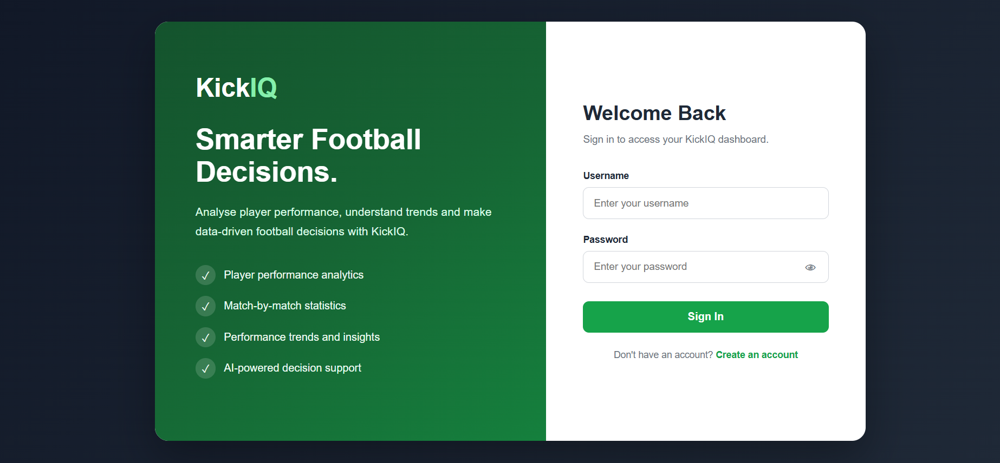 | 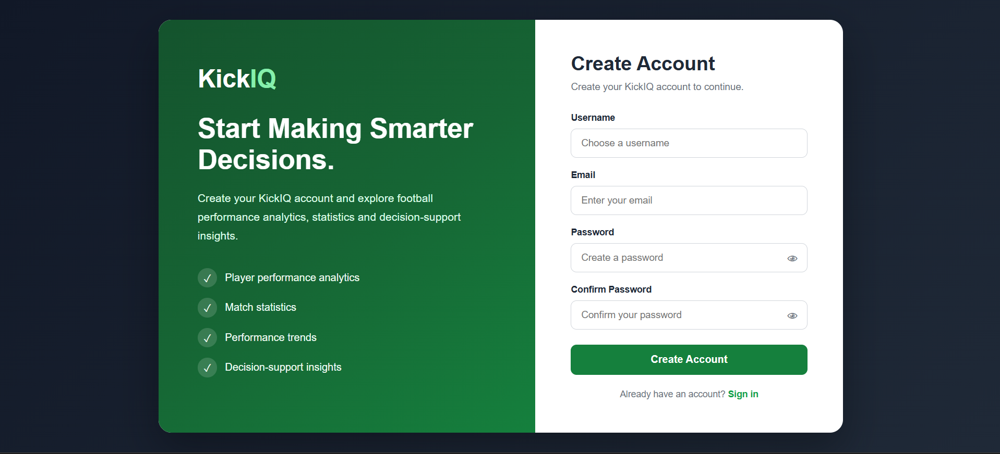 |

### Dashboards
| User dashboard | Admin dashboard |
|---|---|
| 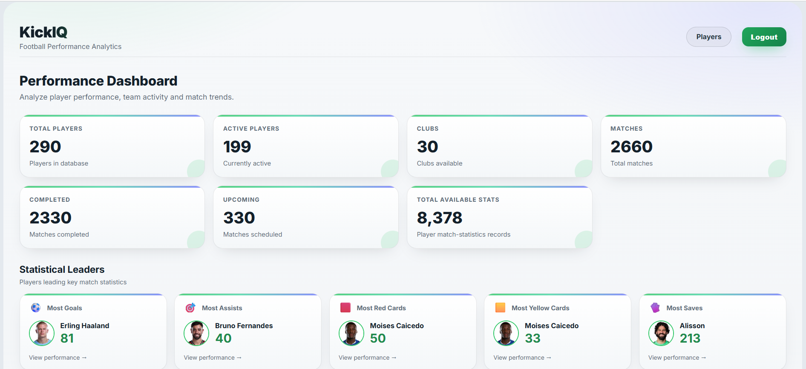 | 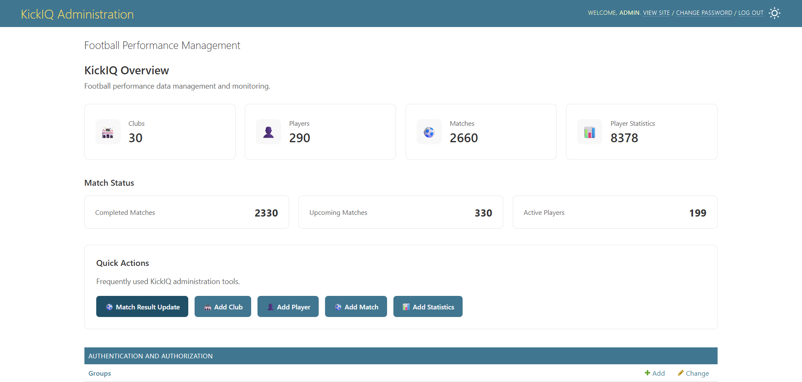 |

### Player discovery and performance
| Player directory | Player profile |
|---|---|
| 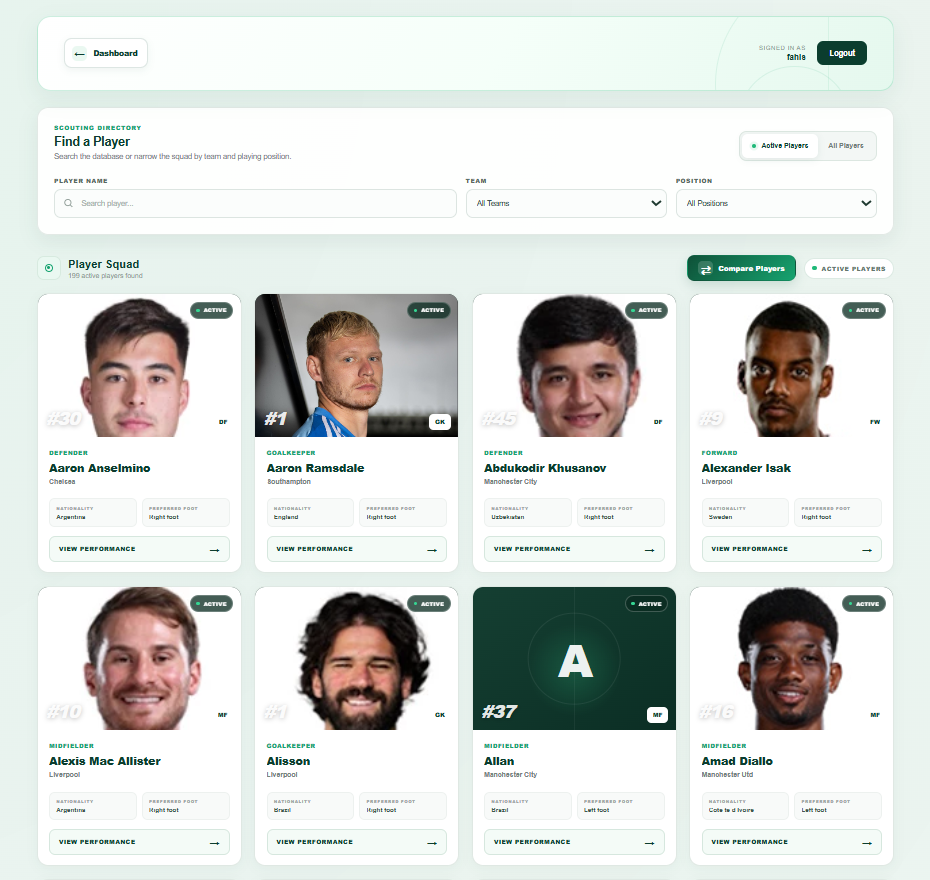 | 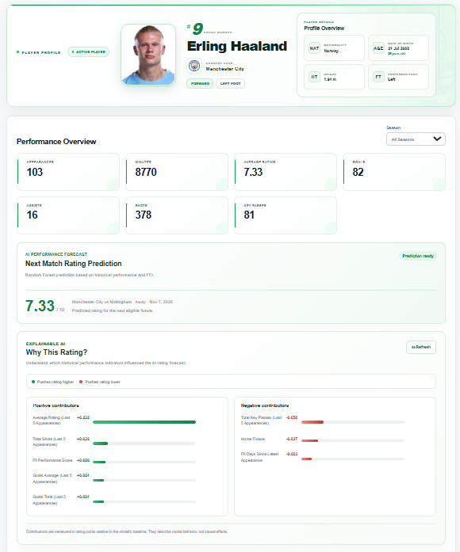 |

| Performance chart | Attribute radar |
|---|---|
| 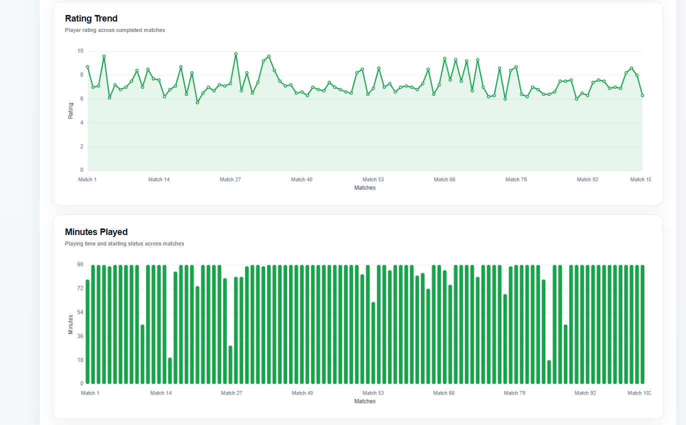 | 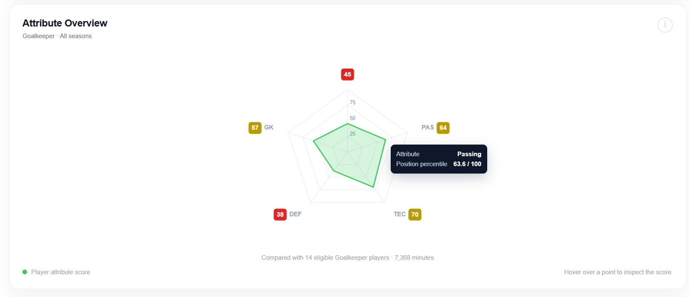 |

### Form, prediction, and analysis
| Football Form Index | Monthly summary |
|---|---|
| 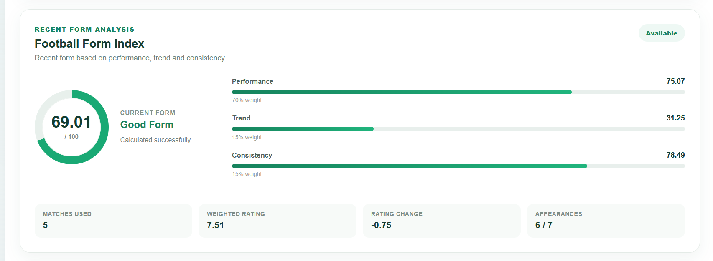 | 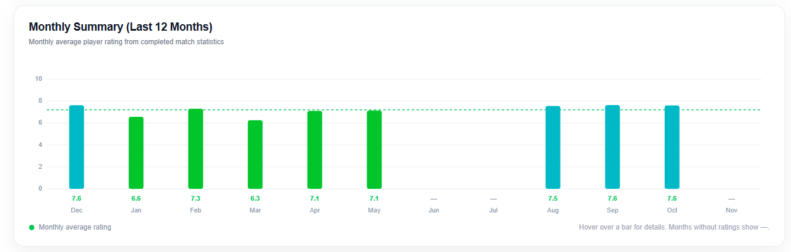 |

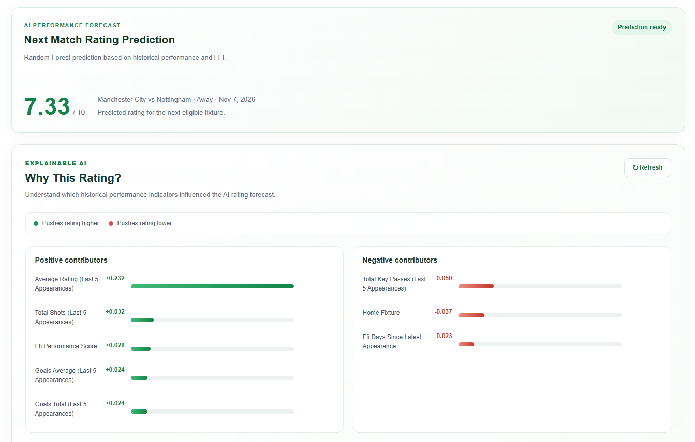

### Comparison and reports
| Player comparison | Player performance report |
|---|---|
| 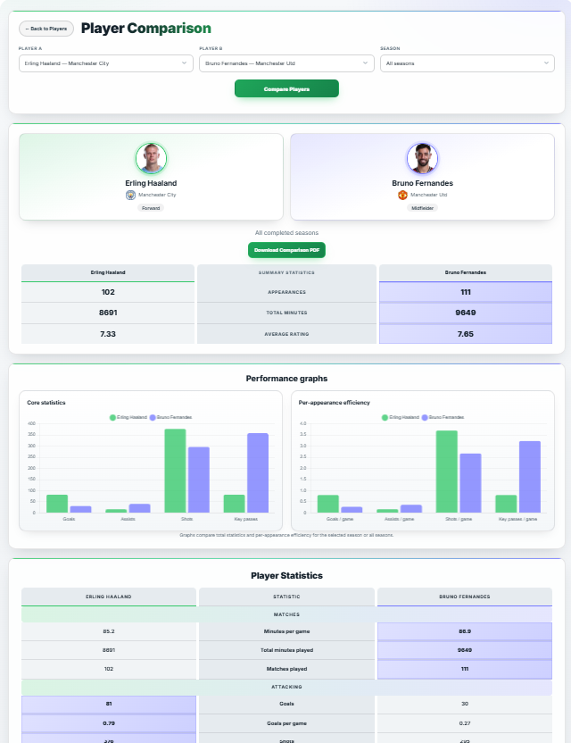 | 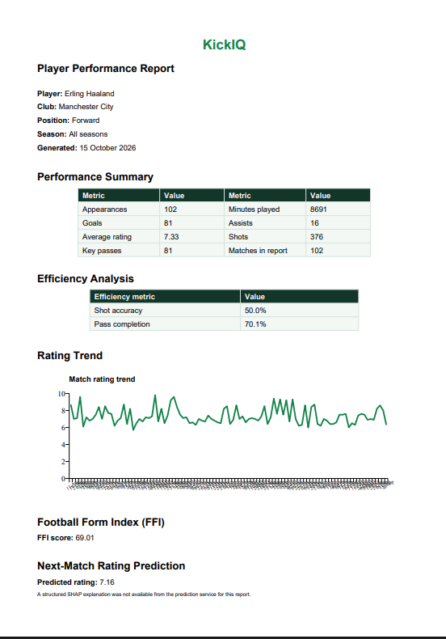 |

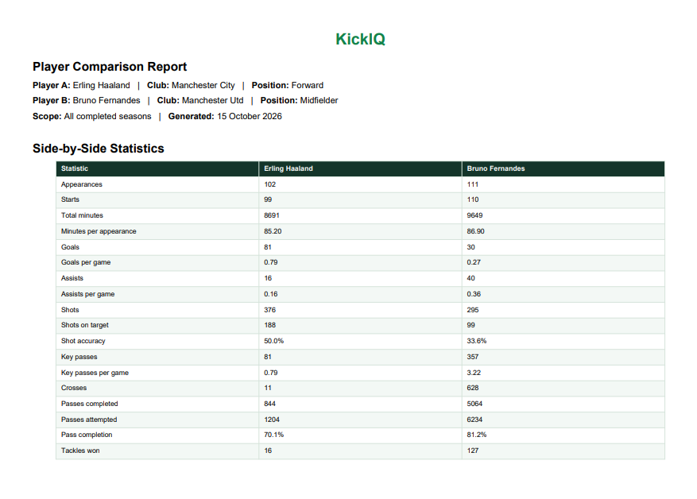

## Technology Stack

| Layer | Technologies |
|---|---|
| Backend | Python, Django 5.2, Django REST Framework |
| Database | MySQL, mysqlclient |
| Frontend | Django Templates, HTML5, CSS3, JavaScript |
| Charts | Chart.js |
| Data processing | Pandas, NumPy |
| Machine learning | Scikit-learn, Random Forest Regressor |
| Explainable AI | SHAP |
| Model persistence | Joblib |
| PDF generation | ReportLab |

The dependency versions currently pinned in `requirements.txt` should be treated as the repository's installation baseline. The prediction/training source also imports machine-learning and reporting libraries; see [Important Notes](#important-notes) and ensure those dependencies are installed in your environment.

## How KickIQ Works

1. Historical match and player-statistics data is imported into the MySQL database.
2. Player history is assembled from eligible completed appearances.
3. FFI is calculated from recent eligible performances and continuity information.
4. The training-data builder creates player-match feature records using historical information available before each target match.
5. A Random Forest regression pipeline is trained using a chronological train/test split.
6. For a player with an eligible upcoming fixture and sufficient history, KickIQ builds the prediction input and estimates a rating on the football-rating scale.
7. SHAP values explain which input features contributed positively or negatively to that estimate.
8. Users can inspect charts, compare players, and generate PDF reports.

The prediction feature is intended for players with eligible historical data and an upcoming fixture. It does not mean that every player in the database is automatically predicted.

## Football Form Index (FFI)

FFI is KickIQ's custom metric for summarising a player's recent performance, rating trend, and consistency.

The implemented weighted formula is:

```text
FFI = (Performance Score × 0.70)
    + (Trend Score × 0.15)
    + (Consistency Score × 0.15)
```

The current implementation in `core/services/ffi.py` uses these rules:

- Considers completed club fixtures and appearances strictly before the target date.
- Uses a preferred window of the most recent 5 rated appearances within the last 7 completed club fixtures.
- Requires at least 3 rated appearances.
- Requires an appearance in at least one of the latest 3 completed club fixtures.
- Uses only appearances with positive minutes and a non-null rating.
- Gives more recent ratings higher weights when calculating the weighted average.
- Calculates a trend score by comparing the two newest ratings with the older ratings.
- Calculates consistency from the population standard deviation of the selected ratings.
- Can evaluate history for a specified club, which helps avoid mixing a player's records from different clubs.

If the eligibility rules are not met, FFI is returned as unavailable rather than fabricating a score.

## Rating Prediction and Explainability

The prediction service is implemented in `core/services/rating_prediction.py`.

- The target is the player's rating in the next scheduled fixture for their current club.
- The service looks for an upcoming fixture and identifies the opponent and home/away context.
- Historical input uses eligible completed appearances for the same club, strictly before the target fixture date.
- The service loads the saved pipeline from `models/kickiq_rating_model.joblib`.
- The saved pipeline contains preprocessing and a Random Forest regressor.
- SHAP TreeExplainer calculates feature contributions for an individual prediction.
- Contributions are sorted by absolute impact and labelled positive, negative, or neutral.

SHAP explains the model's output; it does not establish that a feature caused the player's real-world performance.

## Model Evaluation

The committed model metrics file, `models/kickiq_model_metrics.json`, records the following evaluation:

| Metric | Recorded value |
|---|---:|
| Historical training dataset rows | 7,204 |
| Training records | 5,847 |
| Testing records | 1,357 |
| Input features | 105 |
| Mean Absolute Error (MAE) | 0.5010 |
| Root Mean Squared Error (RMSE) | 0.6403 |
| R² | 0.0017 |

The split is chronological: training data ends on 20 December 2025 and testing begins on 21 December 2025.

**Interpretation:** The recorded MAE is approximately half a rating point on average. However, the R² value is close to zero, which means the model explains very little of the variation in the held-out ratings. These results should be presented transparently; the model is experimental and needs further validation and improvement before being relied on for real-world decisions.

## Project Structure

```text
KickIQ/
├── assets/
│   └── screenshots/          # README application screenshots
├── config/
│   ├── settings.py           # Django settings
│   ├── urls.py               # Main URL configuration
│   ├── asgi.py
│   └── wsgi.py
├── core/
│   ├── management/commands/  # CSV import and data utilities
│   ├── ml/                   # Dataset generation and model training
│   ├── services/             # FFI, analysis, and rating prediction
│   ├── static/               # CSS, JavaScript, and images
│   ├── templates/            # Django HTML templates
│   ├── models.py             # Database models
│   ├── urls.py               # Application/API routes
│   └── views.py              # Application views
├── dataset/                  # Source CSV datasets
├── datasets/                 # Generated training dataset and audits
├── models/                   # Saved model and evaluation outputs
├── manage.py
└── requirements.txt
```

## Getting Started

### 1. Clone the repository

```bash
git clone https://github.com/fahis1099/KickIQ.git
cd KickIQ
```

### 2. Create and activate a virtual environment

**Windows (PowerShell):**

```powershell
python -m venv venv
.\venv\Scripts\Activate.ps1
```

**macOS/Linux:**

```bash
python3 -m venv venv
source venv/bin/activate
```

### 3. Install dependencies

```bash
python -m pip install --upgrade pip
pip install -r requirements.txt
```

The model and report code also imports packages such as scikit-learn, SHAP, Joblib, and ReportLab. Confirm that these are installed in your environment; add the exact compatible versions to `requirements.txt` so a fresh installation is reproducible.

### 4. Configure MySQL

1. Install and start MySQL.
2. Create a database named `kickiq`.
3. Configure the database connection in `config/settings.py` for your local MySQL username, password, host, and port.
4. Do not commit database passwords or Django secret keys. Use environment variables for local and deployment configuration.

Example database creation:

```sql
CREATE DATABASE kickiq CHARACTER SET utf8mb4 COLLATE utf8mb4_unicode_ci;
```

### 5. Apply migrations and create an admin user

```bash
python manage.py makemigrations
python manage.py migrate
python manage.py createsuperuser
```

### 6. Run the development server

```bash
python manage.py runserver
```

Open:

- Application: http://127.0.0.1:8000/
- Django admin: http://127.0.0.1:8000/admin/

## Data Import and Model Workflow

The repository contains Django management commands for importing and maintaining the football data. Run `python manage.py help` to see the commands available in your checkout.

The source includes commands for:
- Importing clubs: `import_clubs`
- Importing players: `import_players`
- Importing matches: `import_matches`
- Importing player statistics: `import_player_statistics`
- Updating match results: `update_match_results`
- Building the training dataset: `build_training_dataset`

Use each command's help option to confirm its required CSV path and arguments before running it. Import clubs, players, matches, and player statistics in the appropriate order, and verify the imported records before training.

The model-training implementation is in `core/ml/train_model.py`. The training dataset builder is in `core/management/commands/build_training_dataset.py`. The saved model and evaluation outputs are under `models/`.

## Important Notes

- **Credential security:** Before sharing or deploying this repository, rotate any credentials that may have been committed in settings files. Keep secret keys and database passwords outside version control.
- **Dependency completeness:** Check that all packages imported by the ML and PDF modules are declared with compatible versions in `requirements.txt`.
- **Local data:** The project expects a MySQL database and the required football datasets. Cloning the source code alone does not populate the database.
- **Model artifact:** The prediction service expects `models/kickiq_rating_model.joblib` to be present.
- **Evaluation limitations:** The current recorded R² is close to zero. Treat predictions as experimental until further validation improves model performance.
- **Development configuration:** Review Django's debug, allowed-host, secret-key, static-file, and database settings before deployment.

## Author

**Mohammed Fahis M**

GitHub: [@fahis1099](https://github.com/fahis1099)

---

*KickIQ — Turning football match data into understandable performance insights.*
